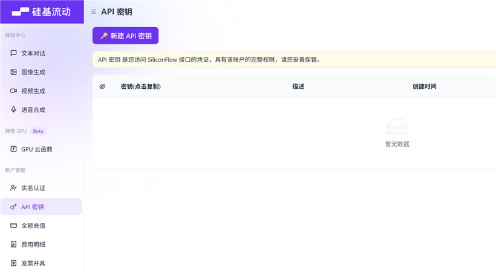
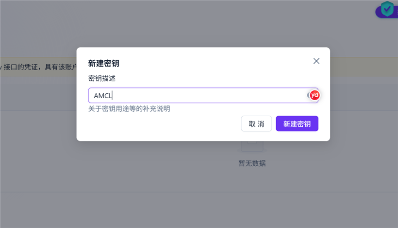
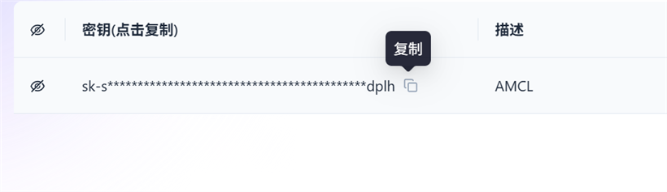

# 连接硅基流动（SiliconFlow）AI 模型

配置一个**有免费额度、国内速度快、工具调用强**的云端 AI，让 AI 助手能处理复杂任务（模糊指令、多步规划、按功能推荐 Mod 等）。

> 💡 支持**微信扫码登录**，不用填一堆注册信息。

---

## 第一步：注册 / 登录

**注册入口（二选一，两个链接都走完整注册流程，效果一样）：**

- 🎗 **邀请入口**：<https://cloud.siliconflow.cn/i/OUCVXBuD> （邀请码 `OUCVXBuD`）
  —— 赞助作者，帮助作者实现 token 自由 🎉

  

- 🌐 **普通入口（不带邀请码）**：<https://api-docs.siliconflow.cn>

> 🎁 新人注册通常**送约 16 元**额度，配置前先注册就能直接用。

进入后用**微信扫码**登录即可（也支持手机号）。

> ⚠️ **需要实名认证**（国内合规要求，很简单）：登录后点左侧菜单「实名认证」，按提示用身份证 / 支付宝实名一下，通常几分钟通过。**实名后才能创建 API 密钥**。

---

## 第二步：创建 API 密钥

1. 点左侧菜单「账户管理 → **API 密钥**」，进入密钥页面。
2. 点击「**＋ 新建 API 密钥**」。

   

3. 填个描述（比如 `AMCL`），点「新建密钥」。

   

4. 创建后密钥以 `sk-` 开头，点旁边的**复制按钮**复制。

   

   > 🔑 密钥是你的凭证，**妥善保管**，别泄露给别人。

---

## 第三步：填进启动器

1. 打开 AMCL 启动器 →「**设置 → 模型**」。
2. 点「**＋ 添加模型**」，服务商选「**硅基流动**」。
3. 展开卡片，把复制的 `sk-...` 密钥粘贴到「**API 密钥**」栏。
4. 「**API 地址**」保持默认（`https://api.siliconflow.cn/v1`）即可。
5. 模型名从**预置列表**里挑，或点「**获取可用模型**」拉取该服务商的完整列表再选。

> 🎯 **怎么选模型**
> - 一般规律：**模型越大越强，越新越强**。
> - **DeepSeek-V4-Flash**：推荐主力——便宜、1M 上下文，对启动器已经够用（甚至过剩）。
> - **比 DeepSeek-V4-Flash 更大的基本没必要**：能力用不上，价格涨得快。
> - **免费档**（Qwen3-8B、R1-Distill-7B 之类）：只有小模型水平，**复杂推理、多步规划、模糊指令都不够用**，适合先试水。
> - 免费档里的例外：**Nex-N2-Pro**（397B MoE，工具调用强），免费又能打，值得试。
> - 中等档可以试 **Qwen3.6-35B-A3B**（35B MoE 只激活 3B，快）或 **Qwen3.5-27B**。

> 💡 硅基流动的模型很多，**可以自己多配几个换着摸索**——不同 AI 在不同任务上表现差别不小。

---

## 第四步：测试连通

1. 点「**获取可用模型**」，能看到模型列表 → 配置成功 ✅
2. 回到 AI 对话框，随便问一句，能看到回答就 OK。

---

## 常见问题

- **401 密钥错误**：密钥复制不全 / 填错，重新复制 `sk-` 开头的完整密钥。
- **额度用完**：免费额度有限，超了可能报错或计费。建议在硅基流动控制台**设额度上限**、看「费用明细」监控用量，避免意外扣费。
- **没反应 / 超时**：检查网络，或换个模型试试。
- **模型名不知道填啥**：点「获取可用模型」，从列表里选一个（Qwen、GLM 系列工具调用较好）。

> 💰 **免费额度会调整**，具体以硅基流动官网为准。工具调用推荐 Qwen / GLM 系列模型。

---

*配置一次即可，之后可随时在「设置 → 模型」调整模型 / 密钥。*
